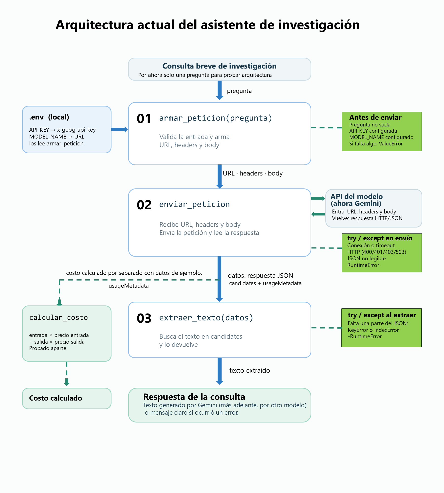

# Elección del modelo para el asistente de investigación

**Fecha de las pruebas:** 20 de octubre de 2026. Ese día medí los tiempos y evalué las respuestas. También consulté los precios publicados. Si volvemos a comparar modelos más adelante, habrá que tomar nuevas mediciones porque tanto los precios como la velocidad pueden cambiar.

## Modelo elegido

Voy a seguir con **Gemini 3.5 Flash-Lite** (`gemini-3.5-flash-lite`) en esta primera versión del asistente.

## Diagrama de arquitectura

El diagrama muestra cómo funciona el programa por ahora: recibe una pregunta escrita, la envía a Gemini y devuelve la respuesta. También guardé la [versión editable](diagrama_arquitectura_editable.pptx). Todavía no le podemos pasar un PDF al programa.

## Comparación de candidatos

| Criterio | Gemini 3.5 Flash-Lite | GPT-OSS 120B mediante Groq | MiniMax M3.1 Flash mediante OpenRouter |
| --- | ---: | ---: | ---: |
| Precio publicado por 1.000 tokens de entrada | US$0,00030 | US$0,00015 | US$0,00015 tras la promoción |
| Precio publicado por 1.000 tokens de salida | US$0,00250 | US$0,00060 | US$0,00060 tras la promoción |
| Latencia promedio medida | **2,19 s** | **1,31 s** | **13,43 s** |
| Calidad en tres preguntas de astronomía | **4,3/5** | **3,7/5** | **4,0/5** |

Para medir el tiempo repetí **la misma pregunta sobre cómo estimar distancias en astronomía** tres veces con cada modelo. Así la comparación es más pareja. Estos fueron los tiempos: Gemini, 2,00; 2,64 y 1,94 s; Groq, 1,98; 1,05 y 0,90 s; MiniMax, 17,49; 11,18 y 11,62 s. Son pocas pruebas, así que otro día los tiempos podrían variar.

Para hacer estas pruebas no pagué: usé el acceso gratuito de cada servicio. Puse en la tabla las tarifas publicadas para uso pagado, pasadas a precio por 1.000 tokens. MiniMax fue un caso especial: su versión gratuita está anunciada solo hasta el **22 de octubre de 2026**; después, la página indica el precio que aparece en la tabla. Consulté las páginas de [Gemini](https://ai.google.dev/gemini-api/docs/pricing), [Groq](https://console.groq.com/docs/models) y [MiniMax en OpenRouter](https://openrouter.ai/minimax/minimax-m3.1-flash:free) el 20 de octubre.

Para mirar la calidad hice tres preguntas de astronomía a cada modelo. Primero pedí una explicación; después, qué revisarían antes de citar una noticia científica; y al final, una posible pregunta de investigación. Les puse nota de 1 a 5 según esas respuestas. Es una evaluación pequeña, no una nota general para cada modelo.

| Pregunta de prueba | Gemini | Groq | MiniMax |
| --- | ---: | ---: | ---: |
| Explicar dos formas de estimar distancias en astronomía y sus límites | 4 | 4 | 4 |
| Decir qué revisar antes de citar una supuesta señal de vida, sin haber leído el artículo | 4 | 4 | 3 |
| Proponer una pregunta de investigación sobre las atmósferas de planetas fuera del sistema solar | 5 | 3 | 5 |

En la primera pregunta los tres explicaron la idea, aunque Gemini y Groq dieron cifras de distancia demasiado tajantes. En la segunda, MiniMax empezó bien, pero el final de su respuesta salió con palabras sin sentido. En la tercera, Groq llamó «calientes» a [K2-18 b](https://science.nasa.gov/universe/exoplanets/webb-discovers-methane-carbon-dioxide-in-atmosphere-of-k2-18-b/) y [GJ 1214 b](https://science.nasa.gov/asset/webb/exoplanet-gj-1214-b-and-its-star-illustration/); al revisar esos planetas, vi que esa descripción no encaja con ambos. Fue una buena muestra de por qué no conviene copiar una respuesta científica sin revisarla.

## Justificación

Me quedo con Gemini porque **fue el que mejor respondió nuestras tres preguntas de astronomía**: obtuvo 4,3/5, frente a 3,7/5 de Groq y 4,0/5 de MiniMax. También respondió bastante rápido para esta etapa. **Groq fue más rápido y tiene un precio publicado menor**; eso cuenta, pero el asistente que quiero construir más adelante va a trabajar con información científica de astronomía. Ahí me importa más que las respuestas sean cuidadosas y que no den por cierto algo dudoso solo por responder rápido. Esto no significa que Gemini siempre vaya a acertar: igual habrá que revisar lo que diga. Además, ya funciona en el código que tenemos.

Más adelante queremos trabajar con artículos, y [Gemini acepta PDF](https://ai.google.dev/gemini-api/docs/models/gemini-3.5-flash-lite). Todavía no he probado esa parte en el programa. Cuando lleguemos a los documentos, habrá que ver si conviene enviar el PDF directamente o convertirlo primero a Markdown. No quiero dar eso por resuelto antes de probarlo con artículos reales.

## Alternativas descartadas y por qué

**GPT-OSS 120B en Groq** queda como alternativa. Respondió muy rápido y cuesta menos según su tarifa publicada, pero en esta prueba Gemini me dio más confianza y Groq se equivocó al describir los planetas de la tercera pregunta. La [ficha de Groq](https://console.groq.com/docs/model/openai/gpt-oss-120b) indica que este modelo recibe texto; si después queremos usarlo con artículos en PDF, habría que sacarles el contenido primero.

**MiniMax M3.1 Flash en OpenRouter** respondió bien en dos preguntas, pero en la otra dejó una frase incomprensible al final. También tardó bastante más en estas pruebas y su acceso gratuito actual es temporal. Por eso tampoco lo elegiría para esta versión.
